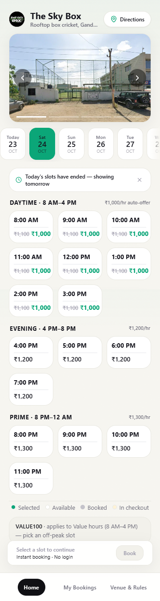
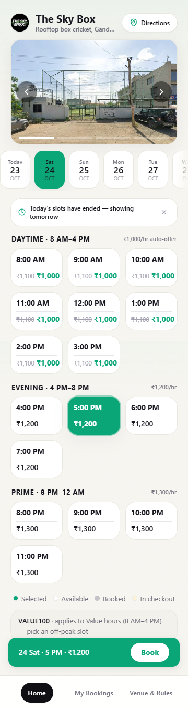
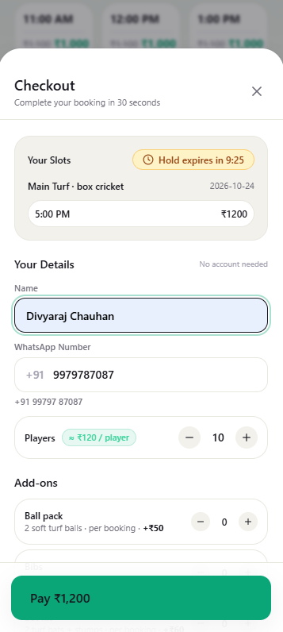
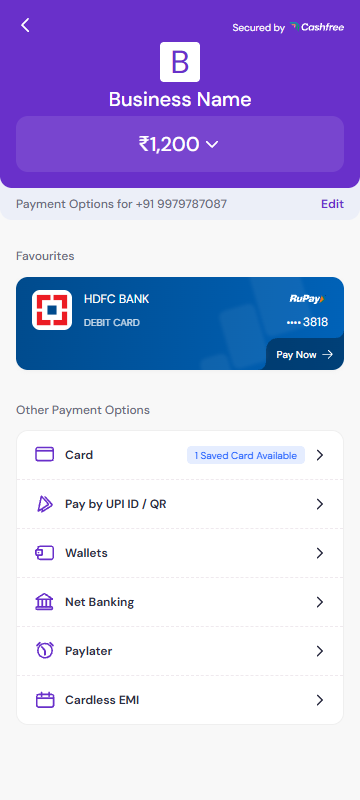
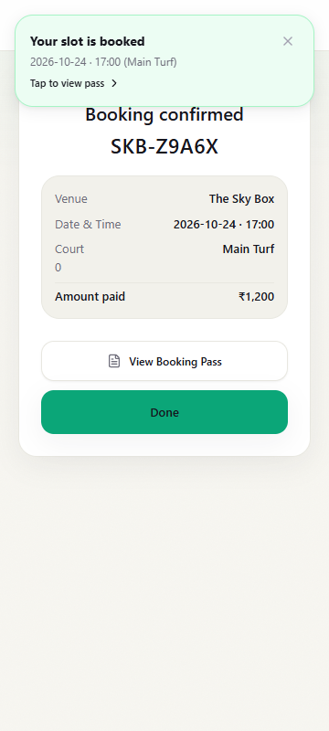
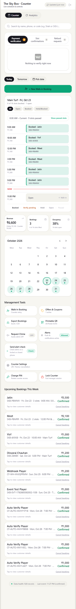
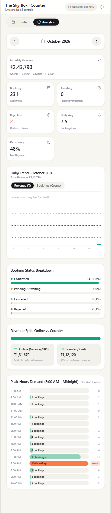

# The Sky Box (TurfLink)

> A real-time, zero-friction slot booking and arena operations platform for box-cricket arenas and multi-sport turfs.

**Live Demo:** [theskybox.vercel.app](https://theskybox.vercel.app/)  
**Portfolio:** [divyarajchauhan.in](https://www.divyarajchauhan.in/)  
**Production Status:** Live Arena Deployment (35+ numbered release iterations)  

---

## 1. Overview

**The Sky Box** (built on the TurfLink platform engine) turns a sports arena's entry QR sticker into an instant booking web application. Players scan a physical QR code at the arena gate, view live real-time slot availability, lock their desired time, and complete instant UPI payment in under 60 seconds—without downloading an app, creating an account, or remembering a password.

On the operational side, arena managers operate from a live console displaying incoming bookings, audio alert notifications, payment verification modals, manual walk-in slot locks, and real-time revenue analytics. Built with a white-label architecture, new sporting arenas can be onboarded via configuration without rewriting application logic.

---

## 2. Key Features

### Player Experience (Zero-Friction Booking)
- **Instant Discovery & Mobile First:** Seamless PWA experience with zero required app store downloads or sign-ups.
- **Real-Time Slot Grid:** Color-coded dynamic time slots (Available, Held, Booked, Past) with automated timezone clamping.
- **Concurrency-Safe Slot Locking:** Temporary 5-minute hold lock mechanism to eliminate double-booking collisions while users check out.
- **Fast UPI & Gateway Checkout:** Integrated UPI payment flow with automated UTR and transaction status polling.
- **Digital Match Pass & PDF Download:** Instant confirmation pass with dynamic QR code verification, downloadable PDF pass, and calendar sync.
- **My Bookings History:** Instant lookup of previous and upcoming passes tied securely to phone verification.

### Arena Operations & Manager Console (`/manage`)
- **Live Day Console:** Real-time chronological view of today's matches, checked-in squads, and upcoming bookings.
- **Audio Alert Hoist Chime:** Audible notifications for front-desk operators whenever an online booking arrives.
- **Manager Payment Verification:** Interactive modal for inspecting UPI transaction references and manually approving/rejecting claims.
- **Walk-in Counter Bookings:** Quick-entry workflow enabling managers to book slots for walk-in cash or offline customers.
- **Manual Slot Blocks & Pricing Overrides:** Granular control over peak-hour rates, maintenance slot blocks, and weather cancellations with instant customer notifications.
- **Live Revenue & Occupancy Analytics:** Daily and monthly slot utilization metrics, peak occupancy hours, and revenue reconciliation.

---

## 3. Tech Stack

| Layer | Technology |
| :--- | :--- |
| **Framework** | Next.js 16 (App Router) & React 19 |
| **Language** | TypeScript (Strict Mode) |
| **Database & ORM** | PostgreSQL with Prisma ORM |
| **Payments** | Cashfree Gateway API & Custom UPI Intent Deep-Links |
| **Styling & Design** | Tailwind CSS & Responsive Dark Sports Theme |
| **Icons & Micro-Interactions** | Lucide React, Iconify & Canvas Confetti |
| **Pass Generation** | PDFKit & Dynamic QRCode Generation |
| **Notifications** | Web Push API & Automated Transaction Sweepers |
| **Testing** | Vitest & Playwright Smoke Suite |
| **Hosting & Edge Infrastructure** | Vercel |

---

## 4. Project Preview

### Customer Booking Flow & Venue Discovery

### Real-Time Interactive Slot Grid

### Fast Checkout & Slot Hold Sheet

### Instant UPI Payment Modal

### Confirmed Digital Match Pass & QR Verification

### Arena Manager Day Console (`/manage`)

### Real-Time Manager Queues & Booking Analytics

---

## 5. Repository Access & Commercial Disclosure

> [!IMPORTANT]
> **Commercial Proprietary Platform**  
> The Sky Box / TurfLink is an active commercial software platform powering live sports facilities. To protect client payment gateway credentials, proprietary concurrency locking algorithms, manager security PIN mechanisms, and white-label multi-tenant infrastructure, the core codebase is maintained in a **Private** repository on GitHub (`diu-ctrl/turflink-core`).
> 
> This public showcase repository (`diu-ctrl/theskybox`) provides an architectural summary, system capabilities overview, and verified interface design. The live production application can be experienced at [theskybox.vercel.app](https://theskybox.vercel.app/).

For licensing, white-label deployment inquiries, or custom venue automation platforms, please reach out via [divyarajchauhan.in](https://www.divyarajchauhan.in/).

---

## 6. Author

**Divyaraj Chauhan**  
- Portfolio: [https://www.divyarajchauhan.in/](https://www.divyarajchauhan.in/)  
- GitHub: [@diu-ctrl](https://github.com/diu-ctrl)  
